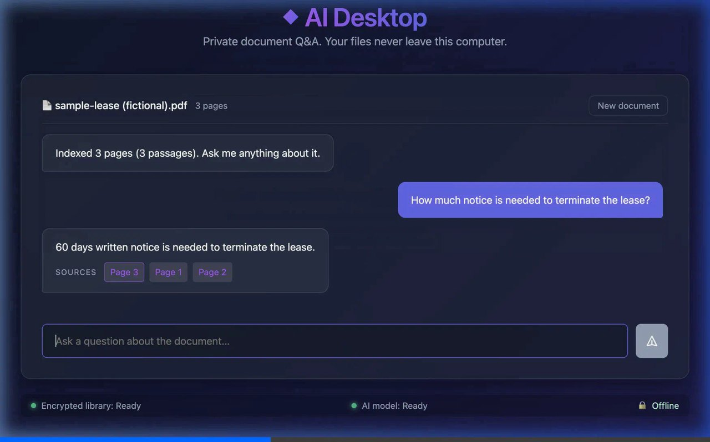

# AI Desktop: private document AI that runs on your machine

A desktop app that answers questions about your documents using an AI model
running **entirely on your own computer**. No cloud, no account, no upload.

▶ [30-second demo video](landing-page/media/demo.mp4) (real recording of v0.1.1)

Built for professionals who handle confidential material and **cannot send it
to a third party**: lawyers, clinics, accountants, consultants, HR, and
anyone bound by client confidentiality or data-protection rules.

> **Status: early preview (v0.1.1).** Drop in a PDF, ask a question, get an
> answer with page citations, all on your machine. Linux x86_64 today.
> See [Current status](#current-status).

## Install (Linux)

Download from the [latest release](https://github.com/anantsaksena/ai-desktop-spike/releases/latest):

- **Ubuntu / Debian / Mint:** `sudo apt install ./ai-desktop-spike_0.1.1_amd64.deb`
- **Any distro:** `chmod +x ai-desktop-spike_0.1.1_amd64.AppImage && ./ai-desktop-spike_0.1.1_amd64.AppImage`

Verify first if you like: `sha256sum -c SHA256SUMS --ignore-missing`.

On first launch the app offers a **one-time download of the AI model**
([Qwen2.5-1.5B-Instruct](https://huggingface.co/Qwen/Qwen2.5-1.5B-Instruct-GGUF),
Apache-2.0, ~1.1 GB). The file is checked against a pinned SHA-256 before it
is ever loaded. After that the app never needs the network again.

---

## Why use this instead of ChatGPT or Claude?

**One reason: your documents never leave your computer, and you can verify
that yourself.**

With ChatGPT, Claude, or any cloud AI, every document you ask about is
uploaded to that company's servers. This applies even on enterprise plans
that promise not to train on your data. For many professionals that is the
problem: the AI provider becomes a third party holding client data. That
can mean client consent, data-processing agreements, HIPAA business-associate
agreements, data-residency rules, or an outright ban by the firm.

This app removes the question entirely:

| | Cloud AI (ChatGPT, Claude, …) | This app |
|---|---|---|
| Where your documents go | Uploaded to the provider's servers | **Nowhere.** They stay on your disk |
| Third party processing client data | Yes | **No** |
| Works with Wi-Fi off / air-gapped | No | **Yes** (after the one-time model download) |
| Account or sign-up | Required | **None** |
| Per-use cost | Subscription or per-token | **Free.** Runs on your hardware |
| Storage | Provider's infrastructure | **Encrypted database on your machine** |
| Can you audit it? | Trust the provider's policy | **Open code. Inspect it, firewall it, watch the traffic** |

### Honest trade-offs

We'd rather you choose this for the right reason:

- **The model is smaller.** A model that fits on a laptop is not as capable
  as ChatGPT or Claude at open-ended reasoning or polished writing. This app
  is built for *finding and citing what's in your documents*, not for
  replacing a frontier model at everything.
- **Speed depends on your hardware.** The default model needs about 2 GB of
  RAM; any laptop from the last few years is fine. Older machines will be slower.
- **The CPU needs AVX2** (almost every x86-64 CPU since ~2013). The app
  checks at startup and tells you clearly if yours doesn't have it.

**Who this is for:** if you *can* paste your documents into ChatGPT, it will
probably give you better answers. This app is for when you **can't**, where
today's alternative is reading through the documents yourself.

---

## How your data is protected

- **Local only.** All three parts (the app, the Python backend, and the
  `llama.cpp` model server) listen only on `127.0.0.1`. Nothing is reachable
  from the network. The **only** outbound connection is the one-time model
  download you start yourself, from a commit-pinned Hugging Face URL. Your
  documents and questions are never sent anywhere. Block the app in your
  firewall afterwards if you want proof.
- **Encrypted at rest.** The whole database is encrypted with
  [SQLCipher](https://www.zetetic.net/sqlcipher/) 4 (AES-256, with per-page
  HMAC tamper detection). This includes the text, the search index, and the
  vectors. Temporary data is kept in RAM, never written to disk unencrypted.
- **Key in your OS keychain.** The encryption key is stored in the macOS
  Keychain, Windows Credential Manager, or Linux Secret Service. Headless
  Linux installs fall back to an owner-only (`0600`) key file. The app
  reports which one is in use, and its limits are documented in
  [`python-backend/storage.py`](python-backend/storage.py).
- **Citations to the exact page.** Each answer points back to the source
  file, page number and character range, so you can check it against the
  original document.

**What is *not* covered:** data in memory while the app is running, your
original source files (they are indexed, not moved or encrypted), and the
model files. Full-disk encryption (FileVault, BitLocker, LUKS) is still
recommended.

---

## Current status

| Area | Status |
|---|---|
| Packaged Linux app (`.deb`, `.AppImage`, x86_64) | ✅ Built and tested in CI |
| Local model server (`llama.cpp`), starts and stops with the app | ✅ |
| One-time verified model download (SHA-256 + size + format pinned) | ✅ |
| Encrypted storage (SQLCipher + full-text search) | ✅ |
| PDF ingestion with page-level citations; scanned pages flagged, not silently skipped | ✅ |
| **Q&A screen**: drop a PDF, ask, get an answer with clickable page sources | ✅ v0.1.1 |
| Supply-chain checks (every build download pinned and verified by content) | ✅ |
| Semantic (vector) search with a dedicated embedding model | 🔜 Planned (keyword/BM25 today) |
| OCR for scanned PDFs | 🔜 Planned |
| Tool integrations (MCP) | 🔜 Planned |
| macOS / Windows installers | 🔜 Builds exist behind a flag. Signed releases planned |

**Supported Linux:** Ubuntu 22.04+, Debian 12+, Fedora 36+, Mint 21+ (glibc ≥ 2.35).

## Tech stack

[Tauri v2](https://tauri.app/) desktop shell (Rust + React) · Python backend
(FastAPI, frozen with PyInstaller) · [llama.cpp](https://github.com/ggml-org/llama.cpp)
for local inference · SQLCipher + FTS5 + [sqlite-vec](https://github.com/asg017/sqlite-vec)
for encrypted hybrid search · [pypdf](https://github.com/py-pdf/pypdf) for PDF parsing
(no AGPL dependencies).

## Building

See [BUILD.md](BUILD.md) for one-command builds, what the CI tests check,
pinned dependencies, and how to enable code signing.
